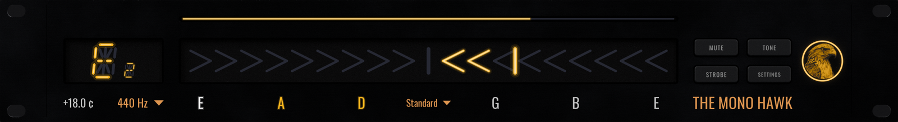
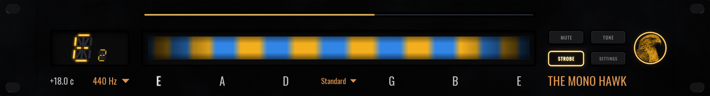
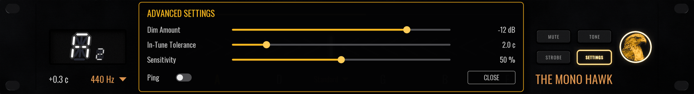
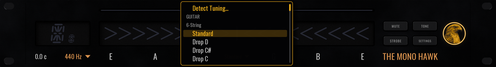
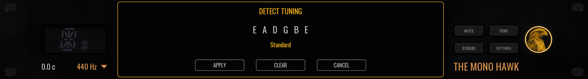

# The Mono Hawk

<p align="center"></p>

The Mono Hawk is a chromatic tuner for guitar and bass that runs on Linux as an LV2
plugin, with its own rack-unit interface. It tracks a single note to
**better than a cent**, down to a 5/6-string bass low B (~31 Hz), and pairs that
precision with a display you can read at a glance while you play.

This is an independent product and is **not affiliated with, endorsed by, or connected to any tuner manufacturer**.

---

> **Full disclosure: This plugin was vibe-coded.**
>
> The Mono Hawk was developed by a musician/audio engineer ([NiLace](https://github.com/NiLace)) directing [Claude](https://claude.ai) (Anthropic's AI) through natural language conversation. The author described what the plugin should do, how it should behave, and how it should look. Claude wrote the C++ code, the DSP algorithms, the UI rendering, the build system, and this README.
>
> The author is not a professional programmer, though he can read C++. Every line of code in this project was generated by AI, then tested and validated by the author in real-world audio production with [Ardour](https://ardour.org) on Linux.
>
> If AI-generated code is a concern for you, this is your notice. The plugin works and it tunes well — but you should know how it was made.

---

## The front panel

<p align="center"></p>

Everything you need while tuning is on one face. From left to right:

- The **note screen** shows the note you're playing — letter, sharp and octave —
  **blue** when you're flat, **amber** when you're sharp, **white** in tune.
  Sharps only, so E-flat reads as D#.
- The thin **amber line** along the top is the input level, so you can see
  signal is actually reaching the plugin.
- The **chevron meter** in the middle is how far off you are: a pointer travels
  with the cents and the chevrons light inward from the edges — toward the left
  and **blue** when you're flat (tune up), toward the right and **amber** when
  you're sharp (tune down). In tune, the pointer becomes a **white** bar in the
  centre. Colours are chosen to stay distinct for colour-blind eyes — flat and
  sharp are never red-versus-green — and the direction is also told by position.
- Under the screens, the **cents readout** (always shown), the **A4 reference**
  (`440 Hz ▾`, click to change it), and the **string row**: the open strings of
  the selected tuning, low string on the left, with the tuning's name in the
  middle (`Standard ▾`) — click the row to open the tuning menu.
- On the right, four buttons — **MUTE**, **TONE**, **STROBE**, **SETTINGS** —
  and the **hawk**. The hawk glows amber while the plugin runs and brighter when
  a string is in tune.
- **The hawk, and the name under the buttons, are the bypass**: click either and
  the plugin passes your signal untouched (the hawk goes dark, the name turns
  white); click again to bring it back. It is the same switch as the host's own
  bypass.

## How it tunes

Play a string and the note screen and chevron meter tell you the note and how
far off it is. The string row doubles as a checklist — the letter of the string
you're playing lights white, and each string's letter turns **amber** the moment
you tune it in and stays lit, so you can work through the whole instrument in any
order. When the last one lands, the row and the hawk glow for a few seconds and
then reset for the next instrument.

## Strobe view

<p align="center"></p>

**STROBE** swaps the chevrons for the rim of a turning disc, amber and blue
stripes. It follows the string's phase against the note: the stripes slide
**right when you're sharp**, **left when you're flat**, faster the further off,
and stand still when you're in tune — the disc then turns green. It shows drift
far finer than the meter, which makes it the view for the last fraction of a cent.
A re-pluck does not stop it.

## Precision, and what "in tune" means

The detector works in two stages. A coarse stage picks the right note (and is
careful about octaves — low strings have a weak fundamental and overtones that
sit slightly sharp, an easy way to misread the pitch an octave too high). A fine
stage then tracks the phase of the signal to pull the cents down below a cent:
the test suite holds it to 0.3 cents on sustained notes from E2 to F#6, and it
reaches down to a 5/6-string bass low B, around 31 Hz.

"In tune" is a small window around the target, not a single razor-thin point —
real strings drift and a perfectly strict tuner would never settle. That window
is the **In-Tune Tolerance** in the settings, two cents by default. Inside it,
the meter's centre bar and the note read white. The measurement itself is far
finer than that window; the band just decides when to call it good.

## Settings

**SETTINGS** opens the Advanced Settings window (click CLOSE, or anywhere
outside it, to close it).

<p align="center"></p>

- **Dim Amount** — how far the MUTE button pulls the output down, in dB. Set it
  deep if you want near-silence while you tune, or leave it shallow to keep
  playing quietly.
- **In-Tune Tolerance** — the half-width of the in-tune window, in cents
  (default 2.0). Smaller is stricter; larger is more forgiving.
- **Sensitivity** — how readily the detector trusts a weak or noisy signal.
  Turn it up for quiet pickups or a soft touch; turn it down if it's picking up
  room noise between notes.
- **Ping** — a short confirmation tone when a string lands in tune. Off by
  default; turn it on here if you like the audible cue.

## TONE and MUTE

**MUTE** dims the output by the Dim Amount, so you can tune without the dry note
blasting through your chain. The rest of the time the plugin is a clean
passthrough — bit-for-bit identical to the input when it isn't dimming — so it
can sit permanently on a track.

**TONE** plays a steady reference pitch for tuning by ear. With it on, the
plugin sounds a sine at the string you're playing (it follows you from string to
string); the note screen shows that string in amber and the cents readout says
**REF**. Click the note screen to step through the strings yourself, and click
REF to move the tone up an octave into a comfortable register.

## Tunings

Fifty of them, picked from a menu that's grouped by instrument and string count
rather than dumped in one long list:

- Guitar, six strings: Standard, the drops, the open (major) tunings, cross-note
  (minor) tunings, modal and suspended tunings like DADGAD, the whole lowered
  family from E-flat down to F, and the regular tunings (all-fourths,
  all-thirds, all-fifths, New Standard, Ostrich).
- Guitar, seven and eight strings: standard and drop.
- Bass, four/five/six strings, with drops.

<p align="center"></p>

If you don't know what something is tuned to, pick **Detect Tuning…** at the top
of the menu and play the open strings **one at a time**: pluck a string, let it
ring for about half a second, then mute it and go to the
next, in any order. Don't let several strings ring together — that is a chord,
and it is ignored. The window lists the notes it has heard and the tuning that
matches them; **APPLY** selects it, **CLEAR** starts over.

<p align="center"></p>

## Why there's no polyphonic mode

A polyphonic (all-strings-at-once) detector was prototyped for this project,
using the method described in Zhou, Reiss et al. (2009).¹ It is not included
here: polyphonic instrument tuning is covered by active patents — originating
with the TC Electronic PolyTune and now held by Music Tribe / Behringer — which
makes a freely-licensed, open-source polyphonic tuner untenable until those
patents expire (around 2030–2031) or are invalidated. So this release is
chromatic only. That, rather than any lack of a working method, is why a free and
open polyphonic guitar tuner doesn't exist on Linux today.

The method itself is written up in
[POLYPHONIC-METHOD.md](POLYPHONIC-METHOD.md) — the knowledge is free even though
the product can't be shipped.

> ¹ R. Zhou, J. D. Reiss, M. Mattavelli, and G. Zoia, "A Computationally
> Efficient Method for Polyphonic Pitch Estimation," *EURASIP Journal on Advances
> in Signal Processing*, vol. 2009, Article ID 729494. doi:10.1155/2009/729494

## Installing it

The easy way — no compiler needed. Grab the prebuilt bundle from the
[**Releases**](https://github.com/NiLace/TheMonoHawk/releases) page and drop it into your personal LV2 folder,
replacing any previous version:

```sh
mkdir -p ~/.lv2
rm -rf ~/.lv2/themonohawk.lv2
tar -xzf TheMonoHawk-0.2.0-linux-x86_64.tar.gz -C ~/.lv2/
```

That leaves `themonohawk.lv2/` under `~/.lv2/`. Restart your host (or rescan plugins) and it shows up as **The
Mono Hawk** — in **Ardour** or any other LV2 host (Carla, Qtractor, Zrythm, REAPER with LV2…). Put it on a **mono**
track and open its interface. To uninstall, delete the folder. If your host scans a different location, extract
there instead (the system-wide path is usually `/usr/lib/lv2` or `/usr/local/lib/lv2`).

The bundle is a 64-bit x86 build for Linux, for generic x86-64 (it runs on CPUs without AVX2). It needs the Cairo,
Xlib and FreeType runtime libraries, which every Linux desktop has. What changed in each version is listed in
[`CHANGELOG.md`](CHANGELOG.md).

## Building from source

You'll need a C++17 compiler, [Meson](https://mesonbuild.com/) with Ninja,
pkg-config, and the LV2, Cairo, Xlib and FreeType development headers.

```sh
meson setup build
ninja -C build           # core, CLI, and the LV2 plugin + GUI
meson test -C build      # the test suites (the GUI's tests need an X display; without one they are skipped)
```

To check it under the sanitizers, use a separate build directory — the install
script refuses a sanitizer build, because a host loading it would exit:

```sh
meson setup build-asan -Dbuildtype=debugoptimized -Db_sanitize=address,undefined
ninja -C build-asan && meson test -C build-asan
```

To install what you built, use the install script. It swaps the libraries in
atomically — writes a temp file and renames it over the old one — because copying
over a `.so` while a host has it memory-mapped will corrupt the running process
and take the host down with it.

```sh
./scripts/install.sh     # builds (release only), then installs to ~/.lv2/themonohawk.lv2/
```

If you rebuild in a way that changes the plugin's port count, remove and re-add
it so the host re-reads the ports.

## Third-party components

- **Font** (`gui/fonts/`) — Oswald, under the SIL Open Font License 1.1 (full text beside it). It stays under the
  OFL and is not relicensed under the AGPL. It travels inside the bundle because the interface draws its screens
  and labels with it directly rather than through the system's font configuration.
- **Interface images** (`gui/assets/`, `assets/images/`) — renders of our own 3D scene of the rack unit, lit with
  the `studio_small_08` HDRI from [Poly Haven](https://polyhaven.com/a/studio_small_08) (CC0); the faceplate's
  metal uses the `Metal009` texture from [ambientCG](https://ambientcg.com/view?id=Metal009) (CC0). The lettering
  in the renders is set in Oswald (SIL Open Font License 1.1). The rest of the interface is covered by this
  project's licence.

## Without a DAW

There's a command-line tuner that reads raw 32-bit-float mono audio from stdin
and prints a live ASCII display:

```sh
arecord -f FLOAT_LE -c 1 -r 48000 -t raw | ./build/tools/hawk_cli
# or with PipeWire:
# pw-record --rate 48000 --channels 1 --format f32 - | ./build/tools/hawk_cli
```

## How this was made, and the license

This plugin was built mainly with **Claude Code** (Anthropic's AI coding agent),
working from my direction on the DSP, the design, and the testing. I can read
C++, but I have not reviewed every line by hand — so please treat it accordingly:

- **No warranty.** It works in my own testing, but it carries no guarantees of
  any kind.
- **No support.** This is a personal project; I can't promise help, fixes, or
  answers.
- **Help is welcome.** If you read code, spot bugs, or want to improve it, review
  and contributions are genuinely appreciated — that's a big part of why it's open.

Released under the **GNU Affero General Public License v3.0, that version only** (`AGPL-3.0-only`) — see
[`LICENSE`](LICENSE). You may use it, study it, modify it and sell it; what nobody may do is close it: any
version you distribute, or let others use over a network, has to come with its complete source under this same
licence. The third-party parts listed above keep their own licences. Contributions are welcome — see
[`CONTRIBUTING.md`](CONTRIBUTING.md).

## Author

Made by **NL Sounds** — <https://github.com/NiLace> · nilace@nylarea.com
